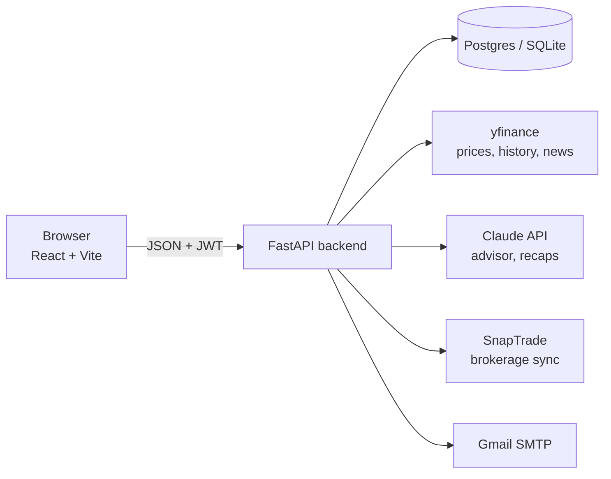

# InnerStock

**A trading journal that checks your reasons against what actually happened.**

Most brokerage apps show you *what* you own. InnerStock asks *why* you bought it, then comes back later to check whether you were right. It tracks your portfolio, makes you write down the reason for every trade, grades each trade against the S&P 500 when its review date arrives, and spots habits that cost you money, such as buying a stock after it has already jumped (FOMO).

**Live app:** https://innerstock.vercel.app. Click **Try the demo** on the login page to look around with a ready-made portfolio. You don't need to sign up.

---

## Features

| | |
|---|---|
| **Portfolio tracking** | Holdings, average cost, and total and daily gain/loss from live prices. Supports US and Canadian (TSX `.TO`) listings. |
| **Trade reasons** | Every trade needs a *why*: a written reason, a confidence score (1–10) and a review date. Trades synced from your brokerage show up in an inbox so you can add their reasons. |
| **Automatic grading** | On the review date, the trade's return is compared with the S&P 500's over the same days. Trades the numbers can judge are graded for you. The rest come back to you with a scorecard. |
| **FOMO check** | Every buy gets a 0–100 "chasing" score from the stock's recent move, its trading volume and your own habits. The app tracks your **FOMO tax**: what chasing buys have cost you compared with buying the S&P 500 instead. ([How it works](#the-fomo-check)) |
| **AI advisor** | A chat advisor (Claude) that knows your holdings, your trade reasons and your track record. Before it answers, it can look up prices, news and earnings, simulate a trade, or run a FOMO check. |
| **Earnings & news** | Upcoming earnings dates and the most relevant news for each stock you own. After a company reports, you get an in-app recap of what happened and what it means, which you can email to yourself. |
| **Brokerage sync** | Imports Wealthsimple trades through SnapTrade. Re-syncing never creates duplicates and keeps the reasons you've written. |
| **Sentiment & bull/bear** | AI summaries of news sentiment and the bull/bear case for any stock. |
| **Accounts** | Sign up, email verification, forgot password, and private throwaway demo accounts. |

---

## The FOMO check

Most FOMO detectors use a fixed rule, such as "the stock rose more than 5% this week". That rule is unfair in both directions: +5% is a normal week for a volatile stock like PLTR and a big week for a broad ETF. It also ignores whether the whole market rose too.

InnerStock measures each run-up against **that stock's own normal week**, after taking out the market's move:

```
         stock's 5-day return  −  market's 5-day return
z  =  ─────────────────────────────────────────────────
       the stock's normal 5-day move (volatility measured
       over the 60 sessions BEFORE the run-up week)
```

The comparison uses the matching S&P 500 fund: SPY for US stocks and VFV.TO for Canadian ones. The 60 sessions end *before* the run-up week, so the run-up isn't counted in "normal" and can't hide itself.

The score adds points from two kinds of signals:

| Signal | Points |
|---|---|
| Unusual run-up (z ≥ 2 / z ≥ 1.5) | +30 / +15 |
| Within 3% of the 20-day high after a run-up | +10 |
| Volume at least 2× the 20-day average | +15 |
| A one-day jump at least 3× a normal day | +10 |
| Bought in the first 30 minutes after the open | +10 |
| At least 2× your usual buy size | +10 |
| A stock you've never traded and never watched | +5 |
| Buying back within 30 days, above the price you sold at | +10 |

The total puts the buy in a band: **Chasing** (60+), **Warm** (30+), **Calm**, or **Dip buy** (bought after a sharp drop).

The app then checks each band against what actually happened:
- **FOMO tax:** the dollars your chasing buys made or lost compared with the S&P 500.
- **Patience test:** how often a chased stock was cheaper a week later.
- **Your own labels:** how many of the buys you tagged "fear of missing out" the detector also caught.
- **Expected cost of your next chase:** your own average, pulled toward the average of other users until you have enough trades of your own.

The code is in [`Backend/fomo.py`](Backend/fomo.py) and the tests are in [`Backend/tests/test_fomo.py`](Backend/tests/test_fomo.py).

---

## Tech stack

| Layer | Tools |
|---|---|
| Frontend | React 19, Vite, Recharts, Tabler Icons (plain JavaScript/JSX) |
| Backend | Python, FastAPI, SQLAlchemy, Alembic |
| Database | SQLite locally, Neon Postgres in production |
| Market data | yfinance (prices, history, earnings, news) |
| AI | Anthropic Claude API (advisor, earnings recaps, sentiment, bull/bear) |
| Brokerage | SnapTrade (Wealthsimple) |
| Email | Gmail SMTP |
| Hosting | Vercel (frontend and backend as separate projects) |
| CI | GitHub Actions: backend tests and frontend build on every PR |



---

## Running it locally

You need **Python 3.14** (the version CI tests with) and **Node 20+**.

### 1. Backend

```bash
cd Backend
python -m venv venv
# Windows: venv\Scripts\activate    macOS/Linux: source venv/bin/activate
pip install -r requirements.txt
cp .env.example .env          # then fill in the two required keys
python init_db.py             # creates innerstock.db and applies all migrations
uvicorn main:app --reload     # http://127.0.0.1:8000  (API docs at /docs)
```

Run the backend from inside `Backend/`, because the imports are flat (`from models import ...`).

### 2. Frontend

```bash
cd Frontend
npm install
npm run dev                   # http://localhost:5173
```

The frontend calls `http://127.0.0.1:8000` by default. To use a different API, set `VITE_API_URL` before you build.

### Environment variables (`Backend/.env`)

| Variable | Required? | Purpose |
|---|---|---|
| `ANTHROPIC_API_KEY` | **Yes** | Claude API key for the advisor, recaps and sentiment |
| `JWT_SECRET_KEY` | **Yes** | Any long random string; signs login tokens |
| `DATABASE_URL` | No | Defaults to local SQLite. Set it only in the deployed environment. |
| `ALLOWED_ORIGINS` | Deployed only | The frontend URL(s) the API accepts requests from (CORS) |
| `GMAIL_ADDRESS`, `GMAIL_APP_PASSWORD`, `APP_URL` | No | Email (verification, password reset, "Email me this"). Without them, email features turn off. |
| `SNAPTRADE_*`, `FIELD_ENCRYPTION_KEY` | No | Brokerage sync. Leave blank to turn it off. See `.env.example`. |

Never commit `.env`. It's gitignored.

---

## Tests

```bash
cd Backend
pip install -r requirements-dev.txt
python -m pytest                          # whole suite (200+ tests)
python -m pytest tests/test_fomo.py       # one file
```

The tests use a fresh in-memory database for each test and fake every outside service (prices, price history, Claude, SnapTrade and email), so they run offline and never touch real accounts. They also cover:
- **Data isolation:** one user can never see another user's data (`test_data_isolation.py`).
- **Migrations:** the database models and the migrations stay in step (`test_migrations.py`).

Frontend checks:

```bash
cd Frontend
npm run lint
npm run build
```

---

## Database changes

Every change to the database tables goes through an Alembic migration:

```bash
cd Backend
alembic revision --autogenerate -m "describe the change"   # review the generated file
alembic upgrade head
```

The production database needs the same migration **before** you deploy code that depends on it. See [Deployment](#deployment).

---

## Deployment

Both halves run on Vercel as separate projects and are deployed with the Vercel CLI:

| Project | Folder | URL |
|---|---|---|
| `innerstock` | `Frontend/` | https://innerstock.vercel.app |
| `innerstock-api` | `Backend/` | https://innerstock-api.vercel.app |

```bash
# 1. If the release includes a migration, apply it to the production database first
#    (run locally, with the production URL set for this one command only)
cd Backend
DATABASE_URL=<production postgres url> alembic upgrade head

# 2. Deploy
npx vercel deploy --prod      # from Backend/, then again from Frontend/
```

Production secrets live in each Vercel project's environment variables (`npx vercel env ls`), never in the repo.

---

## Project structure

```
InnerStock/
├── Backend/
│   ├── main.py              # app setup, most routes, holdings math, advisor context
│   ├── models.py            # database tables
│   ├── fomo.py              # FOMO check (scoring, personal record, routes)
│   ├── grading.py           # scorecards, auto-grading, price history
│   ├── thesis.py            # trade reasons inbox
│   ├── advisor.py           # Claude advisor chat + tools + suggestions
│   ├── holdings_news.py     # earnings dates and news for holdings
│   ├── earnings_recaps.py   # post-earnings recaps and notifications
│   ├── accounts.py          # signup, verification, password reset
│   ├── demo.py              # throwaway demo accounts
│   ├── snaptrade_sync.py    # brokerage sync (with brokerage.py routes)
│   ├── migrations/          # Alembic migrations
│   └── tests/               # pytest suite
├── Frontend/
│   └── src/
│       ├── App.jsx          # screen switching (no router) and auth gate
│       ├── api.js           # apiFetch: every API call goes through here
│       ├── theme.css        # colours and shared styles
│       └── components/      # Dashboard, TradeForm, ThesisInbox, FomoCard, ...
└── CLAUDE.md                # detailed architecture notes
```

For a deeper walkthrough of how each part works, see [`CLAUDE.md`](CLAUDE.md).

---

## Disclaimer

InnerStock is a learning project and a personal journaling tool. Nothing in it is financial advice.
