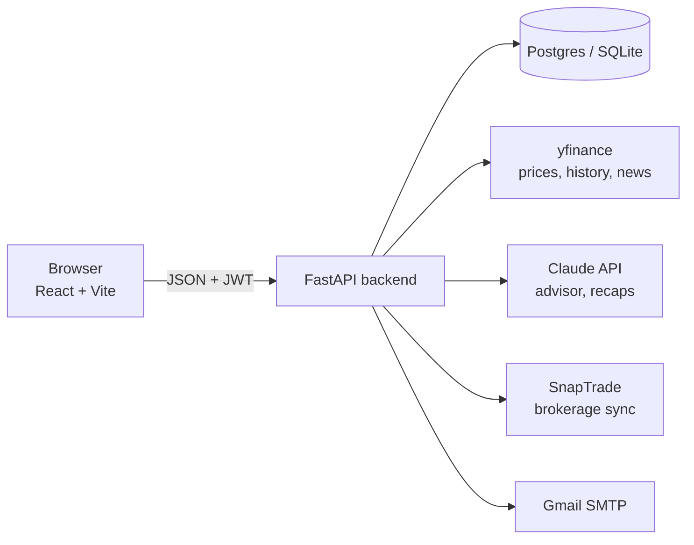

# InnerStock

**A trading journal that checks your reasons against what actually happened.**

Most brokerage apps show you *what* you own. InnerStock asks *why* you bought it, then comes back later to check whether you were right. It tracks your portfolio, makes you write down the reason for every trade, grades each trade against the S&P 500 when its review date arrives, and spots habits that cost you money, such as buying a stock after it has already jumped (FOMO).

**Live app:** https://innerstock.vercel.app. Click **Try the demo** on the login page to look around with a ready-made portfolio. You don't need to sign up.

---

## Features

| | |
|---|---|
| **Portfolio tracking** | Holdings, average cost, and total and daily gain/loss from live prices. Supports US and Canadian (TSX `.TO`) listings. |
| **Trade reasons** | Every trade needs a *why*: a written reason, a confidence score (1–10) and a review date. Trades synced from your brokerage show up in an inbox so you can add their reasons. |
| **Automatic grading** | On the review date, the trade's return is compared with the S&P 500's over the same days. Trades the numbers can judge are graded for you. The rest come back to you with a scorecard. |
| **FOMO check** | Every buy gets a 0–100 "chasing" score from the stock's recent move, its trading volume and your own habits. The app tracks your **FOMO tax** (what chasing buys have cost you compared with the S&P 500), what waiting until it cooled off would have done, and lets you **wait 3 days** instead of buying. ([How it works](#the-fomo-check)) |
| **AI advisor** | A chat advisor (Claude) that knows your holdings, your trade reasons and your track record. Before it answers, it can look up prices, news and earnings, simulate a trade, or run a FOMO check. |
| **Earnings & news** | Upcoming earnings dates and the most relevant news for each stock you own. After a company reports, you get an in-app recap of what happened and what it means, which you can email to yourself. |
| **Brokerage sync** | Imports Wealthsimple trades through SnapTrade. Re-syncing never creates duplicates and keeps the reasons you've written. |
| **Sentiment & bull/bear** | AI summaries of news sentiment and the bull/bear case for any stock. |
| **Accounts** | Sign up, email verification, forgot password, and private throwaway demo accounts. |

---

## The FOMO check

Most FOMO detectors use a fixed rule, such as "the stock rose more than 5% this week". That rule is unfair in both directions: +5% is a normal week for a volatile stock like PLTR and a big week for a broad ETF. It also ignores whether the whole market rose too.

InnerStock measures each run-up against **that stock's own normal week**, after taking out the market's move:

```
         stock's 5-day return  −  market's 5-day return
z  =  ─────────────────────────────────────────────────
       the stock's normal 5-day move (volatility measured
       over the 60 sessions BEFORE the run-up week)
```

The comparison uses the matching S&P 500 fund: SPY for US stocks and VFV.TO for Canadian ones. The 60 sessions end *before* the run-up week, so the run-up isn't counted in "normal" and can't hide itself.

The score adds points from two kinds of signals:

| Signal | Points |
|---|---|
| Unusual run-up (z ≥ 2 / z ≥ 1.5) | +30 / +15 |
| Within 3% of the 20-day high after a run-up | +10 |
| Volume at least 2× the 20-day average | +15 |
| A one-day jump at least 3× a normal day | +10 |
| Bought in the first 30 minutes after the open | +10 |
| At least 2× your usual buy size | +10 |
| A stock you've never traded and never watched | +5 |
| Buying back within 30 days, above the price you sold at | +10 |

The total puts the buy in a band: **Chasing** (60+), **Warm** (30+), **Calm**, or **Dip buy** (bought after a sharp drop).

The app then checks each band against what actually happened:
- **FOMO tax:** the dollars your chasing buys made or lost compared with the S&P 500.
- **Patience test:** how often a chased stock was cheaper a week later.
- **Your own labels:** how many of the buys you tagged "fear of missing out" the detector also caught.
- **Expected cost of your next chase:** your own average, pulled toward the average of other users until you have enough trades of your own.

And it answers the question every chase raises: **what if I had waited?**
- **If you'd waited until it cooled off:** for every hot buy, the check is re-run on each of the next 10 trading days. The first day the stock scores calm is when it "cooled off", and the app shows what buying then would have saved or cost, in dollars.
- **Wait 3 days instead:** when the check flags a buy you haven't made yet, you can wait instead. The app saves the price, and 3 trading days later a notification tells you whether waiting paid off. Buys you *didn't* make become part of your record too.

The code is in [`Backend/fomo.py`](Backend/fomo.py) and the tests are in [`Backend/tests/test_fomo.py`](Backend/tests/test_fomo.py).

---

## Tech stack

| Layer | Tools |
|---|---|
| Frontend | React 19, Vite, Recharts, Tabler Icons (plain JavaScript/JSX) |
| Backend | Python, FastAPI, SQLAlchemy, Alembic |
| Database | SQLite locally, Neon Postgres in production |
| Market data | yfinance (prices, history, earnings, news) |
| AI | Anthropic Claude API (advisor, earnings recaps, sentiment, bull/bear) |
| Brokerage | SnapTrade (Wealthsimple) |
| Email | Gmail SMTP |
| Hosting | Vercel (frontend and backend as separate projects) |
| CI | GitHub Actions: backend tests and frontend build on every PR |


