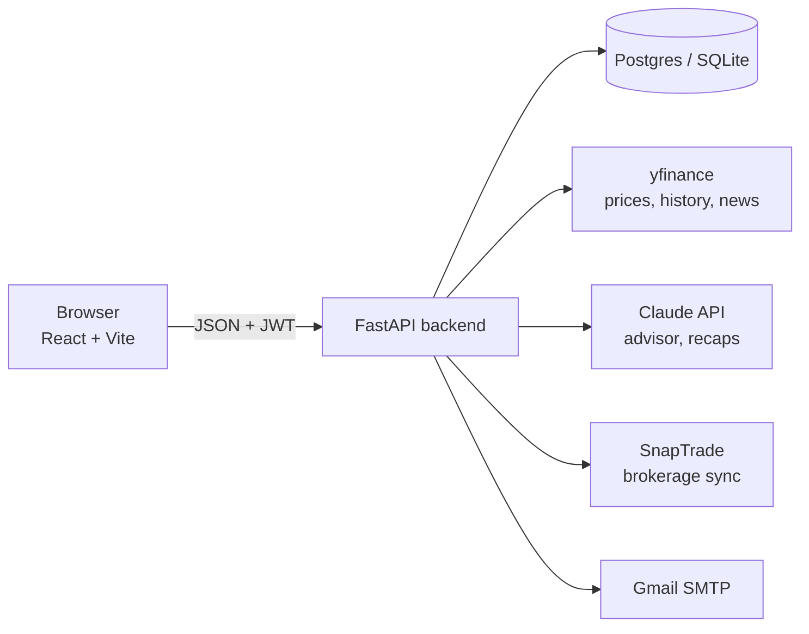

# InnerStock

**A trading journal that checks your reasons against what actually happened.**

Most brokerage apps show you *what* you own. InnerStock asks *why* you bought it, then comes back later to check whether you were right. It tracks your portfolio, makes you write down the reason for every trade, grades each trade against the S&P 500 when its review date arrives, and spots habits that cost you money, such as buying a stock after it has already jumped (FOMO).

**Live app:** https://innerstock.vercel.app. Click **Try the demo** on the login page to look around with a ready-made portfolio. You don't need to sign up.

---

## Features

| | |
|---|---|
| **Portfolio tracking** | Holdings, average cost, and total and daily gain/loss from live prices. Supports US and Canadian (TSX `.TO`) listings. |
| **Trade reasons** | Every trade needs a *why*: a written reason, a confidence score (1–10) and a review date. Trades synced from your brokerage show up in an inbox so you can add their reasons. |
| **Automatic grading** | On the review date, the trade's return is compared with the S&P 500's over the same days. Trades the numbers can judge are graded for you. The rest come back to you with a scorecard. |
| **FOMO check** | Every buy gets a 0–100 "chasing" score from the stock's recent move, its trading volume and your own habits. The app tracks your **FOMO tax**: what chasing buys have cost you compared with buying the S&P 500 instead. ([How it works](#the-fomo-check)) |
| **AI advisor** | A chat advisor (Claude) that knows your holdings, your trade reasons and your track record. Before it answers, it can look up prices, news and earnings, simulate a trade, or run a FOMO check. |
| **Earnings & news** | Upcoming earnings dates and the most relevant news for each stock you own. After a company reports, you get an in-app recap of what happened and what it means, which you can email to yourself. |
| **Brokerage sync** | Imports Wealthsimple trades through SnapTrade. Re-syncing never creates duplicates and keeps the reasons you've written. |
| **Sentiment & bull/bear** | AI summaries of news sentiment and the bull/bear case for any stock. |
| **Accounts** | Sign up, email verification, forgot password, and private throwaway demo accounts. |

---

---

## Tech stack

| Layer | Tools |
|---|---|
| Frontend | React 19, Vite, Recharts, Tabler Icons (plain JavaScript/JSX) |
| Backend | Python, FastAPI, SQLAlchemy, Alembic |
| Database | SQLite locally, Neon Postgres in production |
| Market data | yfinance (prices, history, earnings, news) |
| AI | Anthropic Claude API (advisor, earnings recaps, sentiment, bull/bear) |
| Brokerage | SnapTrade (Wealthsimple) |
| Email | Gmail SMTP |
| Hosting | Vercel (frontend and backend as separate projects) |
| CI | GitHub Actions: backend tests and frontend build on every PR |

